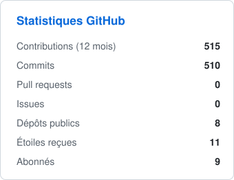
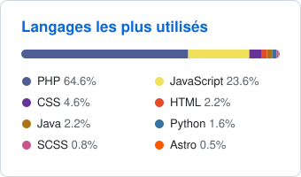
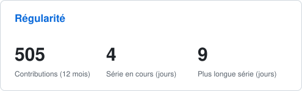

<div align="center">

<!-- HEADER BANNER (SVG local, bascule auto sombre/clair via prefers-color-scheme) -->
<picture>
  <source media="(prefers-color-scheme: dark)" srcset="assets-readme/banner-header.svg">
  
</picture>

<br/>

<!-- Accroche (texte simple : aucune image externe) -->
**🎓 Apprenti informaticien à l'ETML · 3e année**<br/>
**🏠 Homelab 24/7 · Proxmox · 11 LXC · Docker**<br/>
**🔧 Technicien IT indépendant · Lausanne, Suisse**

<br/>

<!-- SOCIAL BADGES -->
[](https://github.com/Tom1419-git)

</div>

---

## 🧑‍💻 À propos de moi

```yaml
nom: Thomas Mayoraz
localisation: Lausanne, Suisse 🇨🇭
formation: ETML — Section Informatique
activités:
  - Apprenti informaticien (ETML, 3e année) — orientation infrastructure
  - Technicien IT indépendant — PME & particuliers, région lausannoise
langues: Français (natif) · Anglais (professionnel)
centres_intérêt: [Infrastructure IT, Virtualisation, Réseaux, Self-Hosting, Scripting]
```

Je conçois, déploie et maintiens des infrastructures qui tournent 24/7. Mon terrain de jeu : un **homelab Proxmox en production réelle** (médias, DNS redondant, automatisation, monitoring) et, en parallèle, une activité de **technicien IT indépendant** auprès de PME et particuliers. Ce qui me distingue : je ne me contente pas de faire marcher — je documente, je sauvegarde et je sécurise tout ce que je construis.

🌐 **Mon site & portfolio** : [mayoraz-net.ch](https://mayoraz-net.ch)

---

## 🏠 Projet phare — Infrastructure personnelle

<div align="center">

<a href="https://mayoraz-net.ch">
  
</a>

**Un homelab en production 24/7 : 11 conteneurs LXC, assistant d'exploitation IA, 3 niveaux de sauvegarde drillé — au service de vrais usages, pas un labo théorique.**

</div>

- 🎬 **Streaming** — Jellyfin + Tdarr, transcodage GPU (VAAPI), accessible partout
- 🛡️ **DNS haute dispo** — Double Pi-hole (failover actif) + DoH, aucune fuite en clair
- 🤖 **Automatisation** — **[Vektor](https://github.com/Tom1419-git/vektor)**, mon assistant d'exploitation IA (bot Telegram, actions à double confirmation)
- 📊 **Observabilité** — Grafana + Loki + Uptime Kuma, alertes avant les pannes
- 🔐 **Accès sécurisé** — NetBird (WireGuard), Authelia, CrowdSec, sauvegardes S3 chiffrées
- 🌍 **Vitrine web** — Portfolio Astro orienté perf (Lighthouse SEO 100), CI GitHub Actions → Cloudflare Workers

---

## 🛠️ Stack technique

<div align="center">

### Systèmes & Virtualisation


### Réseau & Sécurité


-4285F4?style=for-the-badge&logo=wireguard&logoColor=white)


### Développement & Web


### Self-Hosting & Homelab


### Bases de données & Stockage


### Outils


</div>

---

## 📂 Projets

<table>
<tr>
<td width="50%" valign="top">

### 🏗️ Infra Windows Server — `symtech.local`
> **Projet P-188** — Infrastructure complète Windows Server 2022 en PowerShell

- Déploiement AD DS, DNS, DHCP entièrement scripté
- Auth SSH par clés + partages SMB avec permissions NTFS
- GPO (blocage Task Manager employés, logon scripts)
- Automatisation end-to-end via PowerShell

</td>
<td width="50%" valign="top">

### 🏠 Homelab — Proxmox, médias & réseau
> Infrastructure personnelle auto-hébergée, 24/7

- 🎬 **Jellyfin + Tdarr** — Streaming avec transcodage GPU (VAAPI)
- 🛡️ **Pi-hole HA** — DNS redondant + DoH, aucune fuite en clair
- 📊 **Grafana + Uptime Kuma** — Monitoring et alertes Telegram
- 🐳 **Stack Docker** — Sauvegardes chiffrées S3 off-site quotidiennes

</td>
</tr>
<tr>
<td width="50%" valign="top">

### 🔄 WSUS — Automatisation des mises à jour — `zyrtech.local`
> Windows Server 2025 + Windows 11 — Déploiement automatisé

- Automatisation du déploiement des mises à jour Windows
- Configuration SSL/HTTPS + GPO de synchronisation
- Groupes d'ordinateurs + règles d'approbation auto
- Planification et monitoring centralisé

</td>
<td width="50%" valign="top">

### 🌐 VPN Infrastructure — Zyrtech
> RRAS, NPS/RADIUS, PPTP & SSTP avec validation Wireshark

- Serveur VPN (PPTP + SSTP) via RRAS
- Authentification centralisée NPS/RADIUS
- Capture et analyse de trafic avec Wireshark
- Rapport technique complet rédigé en français

</td>
</tr>
<tr>
<td width="50%" valign="top">

### 🐧 Samba AD + Bind9 + DHCP — `pubsoft.local`
> **Projet P_Res-300** — Infrastructure Debian complète

- Contrôleur de domaine Samba AD sur Debian
- DNS dynamique via Bind9
- Intégration DHCP pour attribution automatique
- Jointure de clients au domaine

</td>
<td width="50%" valign="top">

### 🚗 Garage Darbellay — site vitrine client
> Client réel, en production — [garage-darbellay.ch](https://garage-darbellay.ch)

- Site 5 pages (accueil, atelier, location, occasions, infos) livré et en ligne
- Astro + assets statiques, hébergement Cloudflare, aucun CMS à maintenir
- SEO local : données structurées `AutoRepair`, sitemap, `robots.txt`
- Contact direct intégré : téléphone et WhatsApp, sans formulaire
- Réalisé avec l'aide d'outils d'IA pour une partie du code ; cadrage, contenus, recette et mise en ligne par moi

</td>
</tr>
<tr>
<td width="50%" valign="top">

### 📺 Accueil alpin pour Android TV
> Lanceur Android TV en Java, publié sur [GitHub](https://github.com/Tom1419-git/alpine-tv-home)

- Une photo du Riffelsee et du Cervin dont la lumière suit le vrai soleil, de l'aube à la nuit
- Météo réelle (Open-Meteo) : pluie, neige, brouillard, orage, avec des transitions continues
- Lisibilité de l'heure mesurée, bloc musique, screensaver assorti installé automatiquement par ADB
- Testé sur une Sony Bravia (Android 11) ; aperçu navigateur pour voir le rendu sans TV

</td>
<td width="50%" valign="top">

### 🌐 Portfolio — [mayoraz-net.ch](https://mayoraz-net.ch)
> Site Astro bilingue FR/EN, code sur [GitHub](https://github.com/Tom1419-git/mayoraz-net)

- Orienté performance (Lighthouse SEO 100)
- CI GitHub Actions, déploiement sur Cloudflare Workers
- Sert aussi de vitrine à mon activité de technicien IT indépendant

</td>
</tr>
<tr>
<td width="50%" valign="top">

### 💾 Plan de reprise après sinistre (DRP)
> **Rapport R-P_143** — Groupe — Windows Server 2025

- Architecture de backup : Synology NAS + SQLBackupAndFTP
- Sauvegarde MSSQL automatisée
- Procédures DRP documentées et testées
- Architecture cloud hybride (Infomaniak)

</td>
<td width="50%" valign="top">

### ☁️ VMware vSphere — Modules C340 / C-190
> Virtualisation avancée — ESXi imbriqué

- HA, DRS, Enhanced DRS, PMem
- Architecture ESXi imbriquée avec stockage iSCSI
- Diagrammes et infographies d'infrastructure

</td>
</tr>
</table>

---

### 💻 Projets de développement (ETML)

<table>
<tr>
<td width="33%" valign="top">

**🛒 [Scrum-vente](https://github.com/Tom1419-git/Scrum-vente)**
Plateforme e-commerce PHP full-stack (MVC) — catalogue, panier, commandes et back-office, menée en méthodologie Scrum.

`PHP` `MySQL` `MVC` `Scrum`

</td>
<td width="33%" valign="top">

**🎵 [CodificationMorse114](https://github.com/Tom1419-git/CodificationMorse114)**
Couteau suisse C# : encodeur Morse, conversions de bases et stéganographie — sans aucune fonction intégrée.

`C#` `.NET` `Algorithmique`

</td>
<td width="33%" valign="top">

**🎯 [DemoMot-Mastermind](https://github.com/Tom1419-git/DemoMot-Mastermind)**
Mastermind en C# (WinForms) : logique de jeu, statistiques persistantes et exécutable autonome.

`C#` `WinForms` `.NET`

</td>
</tr>
</table>

---

## 💼 Services professionnels — Technicien IT indépendant

Dépannage, installation, infrastructure : j'interviens chez les particuliers
et PME de la région lausannoise avec le même niveau d'exigence que sur mon
homelab — des solutions fiables, documentées et maintenables.


<div align="center">

| 🖥️ Support à distance | 🔧 Intervention sur site | 🏠 Homelab & Self-Hosting |
|:---:|:---:|:---:|
| Dépannage PC / réseau | Installation & configuration | Serveurs média (Jellyfin) |
| Configuration logicielle | Montage & upgrade hardware | DNS custom (Pi-hole) |
| Assistance utilisateur | Déploiement d'infrastructure | Automatisation (n8n, Docker) |
| Conseil & formation | Câblage réseau | Sites web & déploiement d'apps |

</div>

---

## 📊 Statistiques GitHub

<div align="center">

<picture>
  <source media="(prefers-color-scheme: dark)" srcset="assets-readme/stats-dark.svg">
  
</picture>
<picture>
  <source media="(prefers-color-scheme: dark)" srcset="assets-readme/langs-dark.svg">
  
</picture>

<br/>

<picture>
  <source media="(prefers-color-scheme: dark)" srcset="assets-readme/streak-dark.svg">
  
</picture>

<sub>Cartes générées chaque jour depuis l'API GitHub par [un script de ce dépôt](scripts/gen_stats.py), sans service externe.</sub>

</div>

---

## 🧭 Compétences — preuves par projet

| Domaine | La preuve, pas une note |
|---|---|
| **Systèmes Windows** | Infra AD DS complète scriptée (P-188), WSUS automatisé, plan de reprise testé |
| **Virtualisation** | Proxmox VE en production 24/7 (11 LXC) · VMware vSphere (HA, DRS, ESXi imbriqué) |
| **Réseaux** | DNS redondant Pi-hole + DoH · VPN RRAS/NPS · reverse proxy Caddy (12 sites) |
| **Linux** | Samba AD + Bind9 sur Debian · administration LXC/Docker quotidienne |
| **Automatisation** | **[Vektor](https://github.com/Tom1419-git/vektor)** (bot IA à double confirmation), systemd timers, scripts bash/Python, backups chiffrés S3 |
| **Développement** | Lanceur Android TV en Java ([alpine-tv-home](https://github.com/Tom1419-git/alpine-tv-home)) : rendu temps réel, météo, tests unitaires |
| **Développement web** | Portfolio Astro i18n FR/EN (ce site) · e-commerce PHP MVC |
| **Sécurité** | SSO Authelia + 2FA, CrowdSec, SSH par clés uniquement, secrets rotés |

## 🔗 Me contacter

<div align="center">

[](https://github.com/Tom1419-git)
[](https://www.linkedin.com/in/thomas-mayoraz-it/)
[](https://mayoraz-net.ch)
[](https://github.com/Tom1419-git)

</div>

---

<div align="center">

### 💡 *"La meilleure infrastructure est celle qu'on ne remarque pas — parce qu'elle fonctionne."*

<br/>

<picture>
  <source media="(prefers-color-scheme: dark)" srcset="assets-readme/banner-footer.svg">
  
</picture>

</div>
